# How the Installs gallery is made

The Installs page (`/installs`) shows customer cars on FORGED wheels. Every install has three photos: two studio re-shoots made from the customer's own phone photo, and that photo itself. This page explains where each of those images comes from, how to add or correct a car, and what to check before publishing.

The code lives in `scripts/fitment-reshoot/`. The gallery data it generates is `src/data/clientFitments.ts`; the images land in `public/assets/fitments/<slug>/`.

## Overview

1. The shop drops phone photos into the Drive folder *Gallery - Past installations*.
2. Each car gets one entry in `jobs.json`: who it is, what the wheels look like, and any instruction the image model needs.
3. `reshoot_car.py` sends the photo, the job text and an empty studio backdrop plate to Gemini 3 Pro Image through OpenRouter, and keeps a front three-quarter and a side profile on a clean backdrop.
4. A person compares every render with its phone photo on a QA sheet and corrects the job where the model went wrong.
5. `build_site_data.py` copies the approved renders, writes the phone photo as `original.webp` with its number plate pixelated, and regenerates `clientFitments.ts`.
6. The change is committed; the site build picks the images up from `public/`.

## Architecture


> Blue is the render path, light blue the reference images the model sees, orange the human review loop that feeds corrections back into `jobs.json`, green what ends up in the site.

Two things in this picture are easy to miss:

- **The model edits the photo; it does not design a car.** The phone photo is passed as a reference image, so the real body kit, paint and wheels stay. The text in `jobs.json` labels the car and steers details; it cannot repaint a wrongly described car. If a render is wrong, the fix is usually a more precise `extra` instruction and a re-render, not a different `car` string.
- **The backdrop plate is a reference too.** `backdrop_ref.png` is an empty studio set sampled from an approved render. Passing it as the last reference image is what keeps all 22 cars on the same floor and gradient.

## Render lifecycle

One car means two model calls: the front three-quarter first, then the side profile with the front render added as a reference so both read as the same car in the same studio. Each call runs the loop below.


> The score is the percentage of pixels in the car-free top band with a strong luminance gradient. A clean seamless backdrop scores about 0.1 to 0.3; a drawn ceiling, softbox or wall edge scores 0.8 and up. The threshold is 0.5 (`--clean-threshold`), the retry limit is 3 (`--max-tries`), and the best-scoring attempt is kept when none is clean.

What the loop does not catch: a wrong wheel finish, an invented rear wing, a changed body style. Those are only visible to a person, which is why review is its own phase.

## Job fields

Every car is one object in the `jobs` array of `jobs.json`. The animation steps through the groups of fields and what each one drives.


> `slug`, the identity fields, `wheelLook`, `car`, `sources` and `plates` are required. The optional fields add rows to the lightbox only when present. Editing `car`, `sources` or `extra` means re-rendering; editing anything else only needs `build_site_data.py`.

The car identity fields were first read off the phone photos and are a best reading, not a confirmed spec. The shop should check make, model generation and paint name before a car goes live.

## Pipeline phases


> Rendering is the only phase that costs money: about US$0.14 per image at 2K, two images per car, plus one per re-roll. `raw/`, `out/` and `logs/` are git-ignored working folders; only the six WebPs per car and the data file are committed.

The commands, run from `scripts/fitment-reshoot/`:

```bash
# 2. render every job, four cars at a time (or name slugs to render a subset)
OPENROUTER_API_KEY=... PAR=4 RES=2K ./batch_reshoot.sh
OPENROUTER_API_KEY=... ./batch_reshoot.sh g80-m3-black-bronze

# 3. one row per car: phone photo | front 3/4 | side
python3 qa_sheet.py out

# re-render a single angle after correcting the job
OPENROUTER_API_KEY=... python3 reshoot_car.py --jobs jobs.json --slug <slug> \
  --rawdir raw --outdir out --angles side --backdrop-ref backdrop_ref.png

# 4. copy renders, write original.webp with plates hidden, regenerate clientFitments.ts
python3 build_site_data.py --site ../.. --rawdir raw

# 5. from the repository root
npm test && npm run lint && npm run build
```

## Reviewing renders against the photos

Open the QA sheets and look at each row with the phone photo next to it. In order of how often the model gets them wrong:

| Check | What went wrong in the first batch | Fix |
|-------|-------------------------------------|-----|
| Wheel colour and spoke design | A brushed-silver many-spoke wheel was rendered in bronze with fewer spokes | Describe the finish and spoke count in `extra`, say what it is *not*, re-render |
| Invented parts | A GT wing appeared on a car whose boot is standard | `extra`: "There is NO rear wing on this car", re-render |
| Backdrop | A studio ceiling was drawn in 19 of 22 cars before the backdrop plate existed | Keep `--backdrop-ref`; the score check re-rolls the rest |
| Body style | A Touring could come out as a sedan | `extra`: "This is the Touring (estate) body: keep the long roof and tailgate" |
| Paint | Dim or tinted photos can shift the colour | `extra`: name the paint and ask for neutral studio light |
| Make | The Audi needs its own front end | `extra`: "This is an Audi, not a BMW; keep the RS3 grille and badges" |

A render that matches the photo in body style, paint, wheel design and finish, with nothing added, is approved. Rename the slug if the correction changed what it says about the car, since the slug names the asset folder.

Then mark the number plate. Measure the plate's box on the rotated photo in percent and put it in `plates`; use `[]` when no plate is visible. After building, check the pixelated area in `original.webp` actually covers the characters, and widen the box if it does not. Plates on other cars in the background count too.

## What the site shows

- The gallery card shows the front three-quarter render. Tapping it opens a lightbox with three photos: front three-quarter, side profile, then the owner's photo, labelled for screen readers. Arrow keys and the thumbnails move between them. The owner's photo is shown whole rather than cropped to 4:3.
- The lightbox lists the wheels (the catalogue name when `wheelModel` is set, otherwise `wheelLook`), plus sizes, finish and location when those fields are filled, and opens WhatsApp with the car named.
- `src/data/clientFitments.test.ts` fails the build if an install does not have exactly three images in its own folder, if a referenced file is missing from `public/`, or if the slot labels are out of sequence.
- The home page shows the first few installs with the same data.

## Limits worth knowing

- The Drive connector used to fetch photos refuses files over 10 MB. Larger photos need a smaller copy in Drive or a manual drop into `raw/`.
- HEIC photos need `pip install pillow-heif` for `build_site_data.py` to read them.
- The site has no per-install page; the slug is an id, not a route.
